# OrderFlow

OrderFlow is a cloud-native order-management API built with FastAPI and PostgreSQL. It demonstrates a production-minded delivery path: tested application code, Entra ID-protected business endpoints, immutable and signed container images, infrastructure as code, automated staging deployment, approval-gated production promotion, canary rollout, observability, alerting, and tested recovery.

> **Project status:** completed Azure delivery exercise. The application platform was intentionally deprovisioned after successful production validation on 18 November 2026. This repository preserves the reproducible infrastructure, CI/CD configuration, runbooks, artifacts, and captured operational evidence.

## Verified deployment

The production release was verified through `/health`, `/ready`, `/info`, protected order-lifecycle requests, and the OpenAPI interface. The screenshots and Jenkins artifacts below document the deployed environment, immutable image, authenticated API access, progressive rollout, monitoring, backup posture, and cost controls.

## What this project demonstrates

- **API engineering:** FastAPI, SQLAlchemy, PostgreSQL, Alembic migrations, validation, health checks, and automated tests.
- **Container delivery:** Docker image builds, Trivy image and IaC scanning, CycloneDX SBOM generation, Azure Container Registry, immutable SHA-256 digests, and build identity exposed through `/info`.
- **Infrastructure as code:** Terraform-managed staging, production, networking, secrets, monitoring, alerts, backups, and an Azure Monitor Workbook.
- **Configuration management:** Ansible configures a Jenkins VM, Docker Compose stack, Caddy reverse proxy, and a Jenkins build agent.
- **CI/CD:** GitHub webhook-triggered Jenkins pipeline with tests, signed image publication, migrations, staging verification, manual production approval, and canary promotion.
- **Identity and supply chain security:** Microsoft Entra ID role-based API authorization, Azure managed identities, Azure Key Vault, and Cosign image signing and verification with a Key Vault-backed key.
- **Operations:** Application Insights OpenTelemetry instrumentation, Log Analytics, availability testing, 5xx monitoring, email alerts, cost budget alerts, and tested recovery procedures.

## Architecture

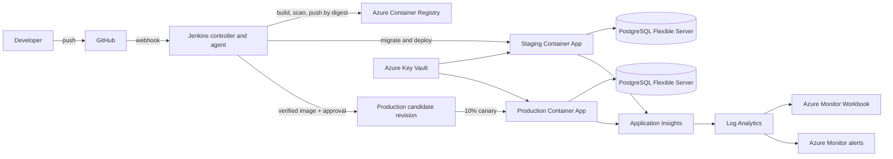

## Delivery workflow

1. A push to `main` triggers Jenkins through a GitHub webhook.
2. Jenkins formats and lints the code, runs unit and PostgreSQL integration tests, validates Terraform, builds the API image, and scans the image and infrastructure with Trivy.
3. Jenkins creates a CycloneDX SBOM, publishes the image to Azure Container Registry, resolves its immutable digest, and signs it with Cosign using Azure Key Vault.
4. Jenkins verifies the signature and provenance annotations before deploying the digest to staging.
5. A Container Apps Job runs the database migration against staging.
6. Staging deploys the same digest, waits until `/info` reports the expected Git SHA, then runs health, readiness, authenticated order-lifecycle, and anonymous-access rejection smoke tests.
7. A manual approval gate protects production.
8. Jenkins verifies the image signature again before production migration and release.
9. Production migrations run before a zero-traffic candidate revision is created and validated.
10. The candidate receives 10% of production traffic. The pipeline verifies that it receives live traffic, checks candidate 5xx metrics, then either promotes it to 100% or restores the previous revision.
11. A final production smoke test and build-SHA check confirm the release.

### Release evidence

Every successful Jenkins release archives machine-readable evidence alongside test coverage:

- `coverage.xml` - test coverage report.
- `sbom.cdx.json` - CycloneDX software bill of materials for the built image.
- `release-evidence.json` - image digest, source revision, Jenkins build, and signing-key reference.
- `cosign-verify-staging.json` and `cosign-verify-production.json` - signature-verification results for the promoted artifact.

## Production observability evidence

The Terraform-provisioned production workbook presented availability, request health, latency, failed requests, PostgreSQL dependencies, and exceptions in one place.

| Availability tests | Production request traffic |
| --- | --- |
|  | 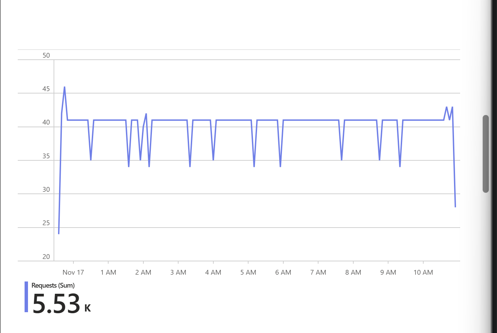 |

| Endpoint health | PostgreSQL dependency telemetry |
| --- | --- |
|  | 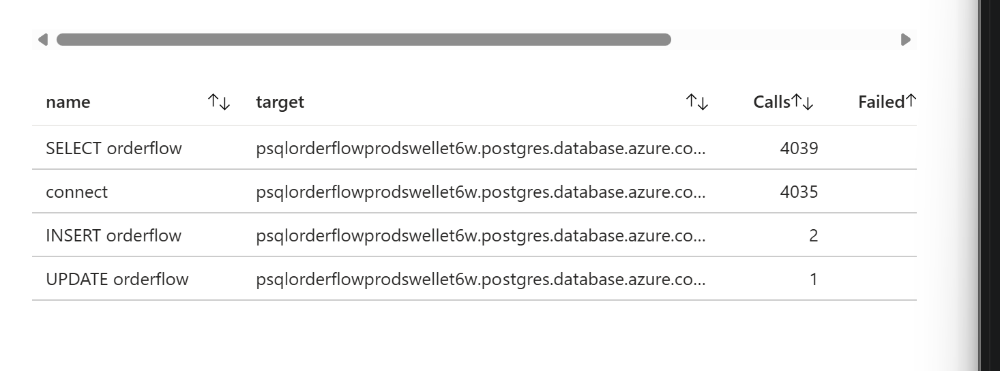 |

The screenshots above were captured on 17 November 2026. They show passing availability probes from West Europe, 5.53k requests over the preceding 24 hours, a 0.07% request failure rate, and live PostgreSQL dependency traces. The recorded failures are expected `404` responses for browser requests to `/` and `/favicon.ico`; the health, readiness, and order endpoints were healthy during the evidence window.

### Monitoring and alerting

- Application Insights receives FastAPI, HTTP, exception, and SQLAlchemy/PostgreSQL telemetry through OpenTelemetry.
- Azure Monitor runs a production `/health` availability test from West Europe.
- Email alerts notify the production action group on health-test failure and server-error conditions.
- A monthly Azure budget sends notifications at 50%, 80%, 100%, and forecasted 100% consumption.

## Security and resilience

- Production PostgreSQL has public network access disabled and uses private networking and private DNS.
- Application secrets, including the database URL and Application Insights connection string, are stored in Azure Key Vault.
- Jenkins authenticates to Azure with a user-assigned managed identity rather than stored cloud credentials.
- The `/orders` business API requires a Microsoft Entra ID bearer token containing the `OrderFlow.Orders.ReadWrite` application role; unauthenticated requests are rejected with `401`.
- Each promoted image is signed with Cosign using an Azure Key Vault EC key and verified in the pipeline before staging and production use.
- The Jenkins VM is protected by Azure Backup; a disk-recovery drill restored an isolated OS disk successfully.
- PostgreSQL point-in-time recovery was tested by restoring a private temporary server, validating the `orderflow` database, and deleting the drill resources.
- The production recovery procedure is documented in [the recovery runbook](docs/runbooks/production-recovery.md).

## Delivery and operational evidence

The following evidence was captured from the production platform and Jenkins build `#33` on 18 November 2026. The release promoted immutable image digest `sha256:762af119...c9042f` from commit `83ed815`.

| Active production release | Jenkins release evidence |
| --- | --- |
| 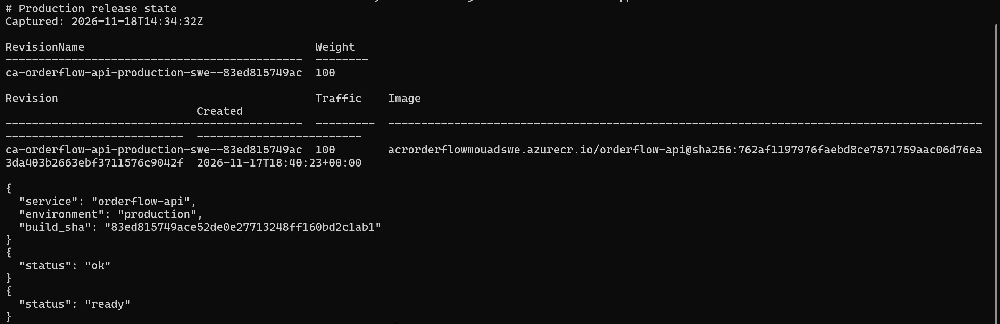 | 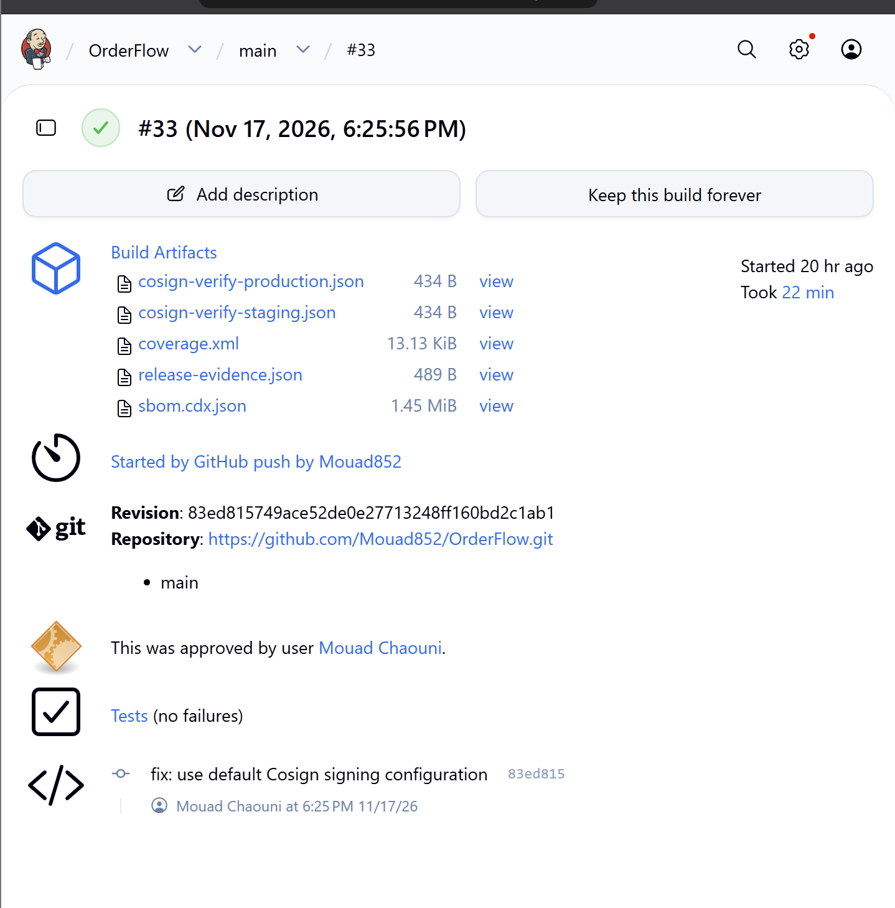 |

| Image signed through Azure Key Vault | Signature verified before deployment |
| --- | --- |
| 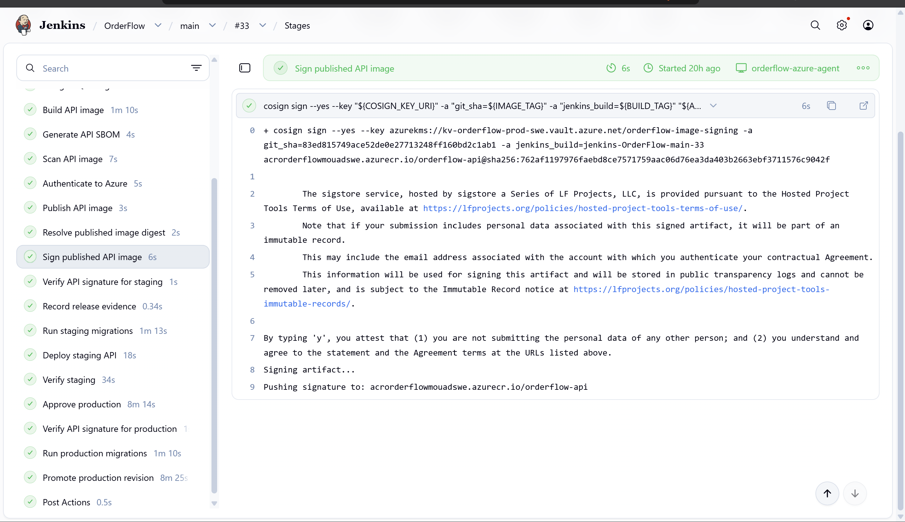 | 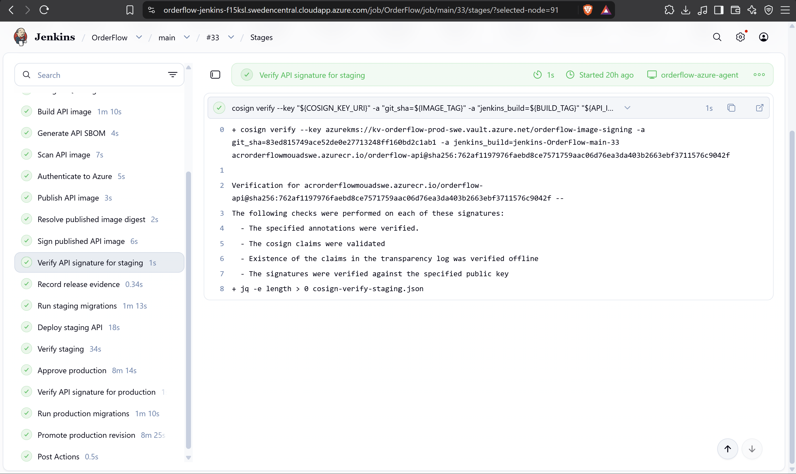 |

| Anonymous request rejected | Managed identity request accepted |
| --- | --- |
| 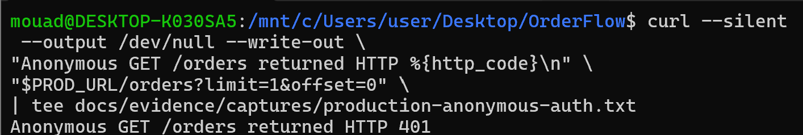 | 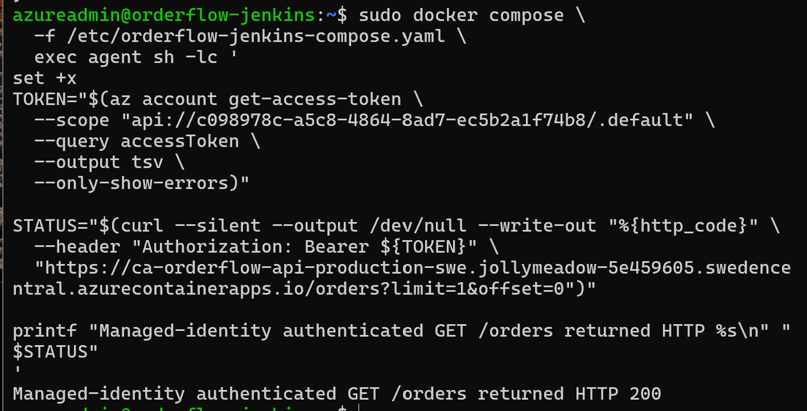 |

### Progressive delivery

The production rollout began with the previous revision at 90% and the candidate at 10%. After the candidate received live traffic and passed its 5xx metric gate, traffic was promoted to the candidate revision at 100%.

| 90/10 traffic split | Candidate error-rate gate |
| --- | --- |
| 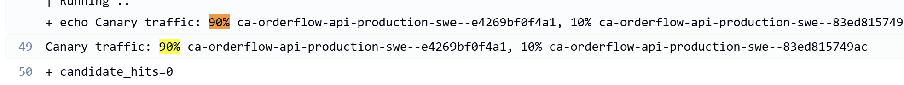 | 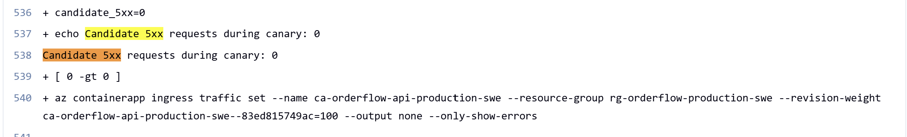 |

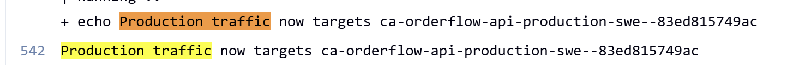

### Backup, database, and cost controls

| Jenkins backup health | Production PostgreSQL posture |
| --- | --- |
| 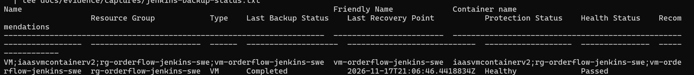 | 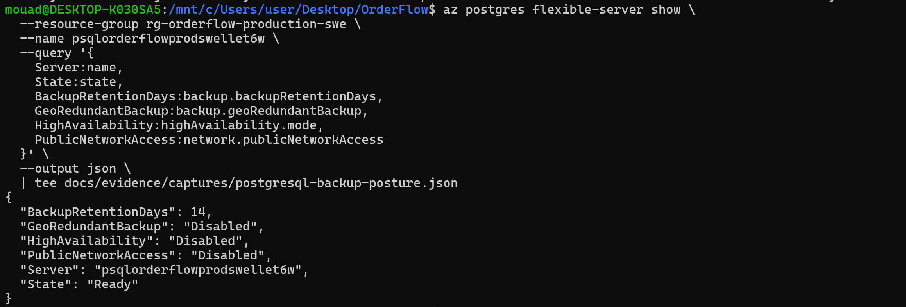 |

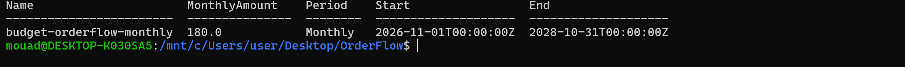

## Technology stack

| Area | Technology |
| --- | --- |
| API | Python, FastAPI, Pydantic, SQLAlchemy |
| Database | Azure Database for PostgreSQL Flexible Server, Alembic |
| Containers | Docker, Docker Compose, Azure Container Apps, Azure Container Registry |
| Infrastructure | Terraform, Azure Key Vault, Azure Virtual Network, Private DNS |
| CI/CD and supply chain | Jenkins, GitHub webhooks, Trivy, CycloneDX, Cosign, Azure Key Vault |
| Configuration | Ansible, cloud-init, Caddy |
| Observability | OpenTelemetry, Application Insights, Log Analytics, Azure Monitor Workbooks and Alerts |
| Resilience | Azure Backup, PostgreSQL point-in-time restore, Azure Cost Management budget |

## API

| Method | Path | Purpose |
| --- | --- | --- |
| `POST` | `/orders` | Create a `PENDING` order; Entra token required in Azure. |
| `GET` | `/orders?limit=&offset=` | List orders with pagination; Entra token required in Azure. |
| `GET` | `/orders/{order_id}` | Retrieve one order; Entra token required in Azure. |
| `PATCH` | `/orders/{order_id}/cancel` | Cancel a `PENDING` order; Entra token required in Azure. |
| `GET` | `/health` | Check that the API process is alive. |
| `GET` | `/ready` | Check that PostgreSQL is reachable. |
| `GET` | `/info` | Report service identity, environment, and deployed Git commit. |

Example request:

```bash
curl --request POST http://localhost:8000/orders \
  --header 'Content-Type: application/json' \
  --data '{
    "customer_reference": "customer-123",
    "items": [
      {
        "product_sku": "coffee-beans",
        "quantity": 2,
        "unit_price": "12.50"
      }
    ]
  }'
```

Money values are decimal strings. New orders are `PENDING`; only `PENDING` orders can be cancelled.

For local development, authentication is disabled by default. Azure deployments set `AUTH_ENABLED=true`; use a valid Entra access token with the required application role when calling business endpoints.

## Run locally

From WSL in the repository root:

```bash
docker compose up --build -d
docker compose ps
bash scripts/smoke-test.sh
```

The local API is available at:

- Interactive documentation: <http://localhost:8000/docs>
- Liveness: <http://localhost:8000/health>
- Readiness: <http://localhost:8000/ready>

Stop the containers while preserving local database data:

```bash
docker compose down
```

To delete the local PostgreSQL volume as well, run `docker compose down -v`.

## Quality checks

```bash
uv run ruff format --check .
uv run ruff check .
uv run pytest
git diff --check
```

## Repository layout

```text
app/                FastAPI application, database models, services, telemetry
ansible/            Jenkins host and agent configuration
docker/             API container image definition
jenkins/            Declarative CI/CD pipeline
scripts/            Smoke tests and operational helpers
terraform/          Staging, production, and Jenkins infrastructure
tests/              Unit and integration tests
docs/               Architecture decisions, runbooks, and observability images
```

## Useful documentation

- [Production recovery runbook](docs/runbooks/production-recovery.md)
- [Sweden Central and shared Container Apps environment decision](docs/decisions/0003-sweden-central-and-shared-container-apps-environment.md)
