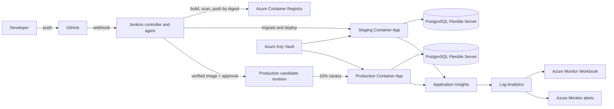
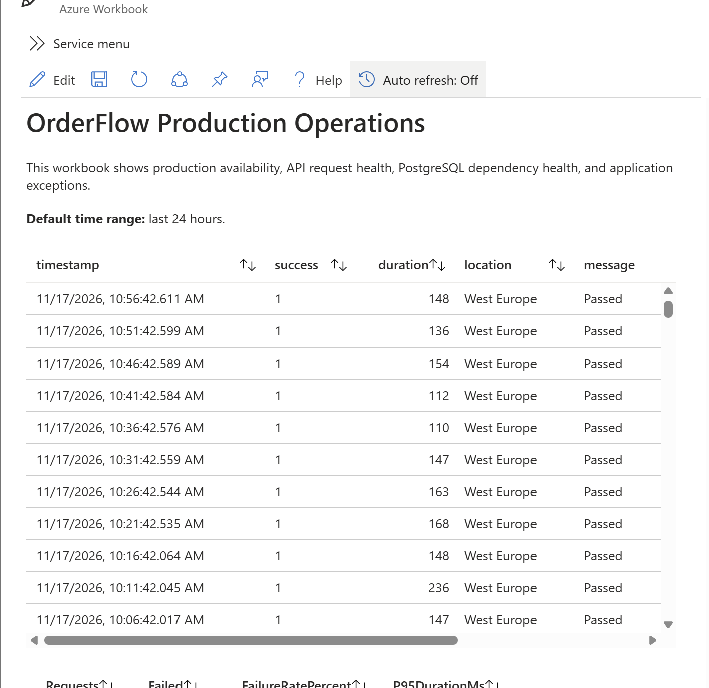
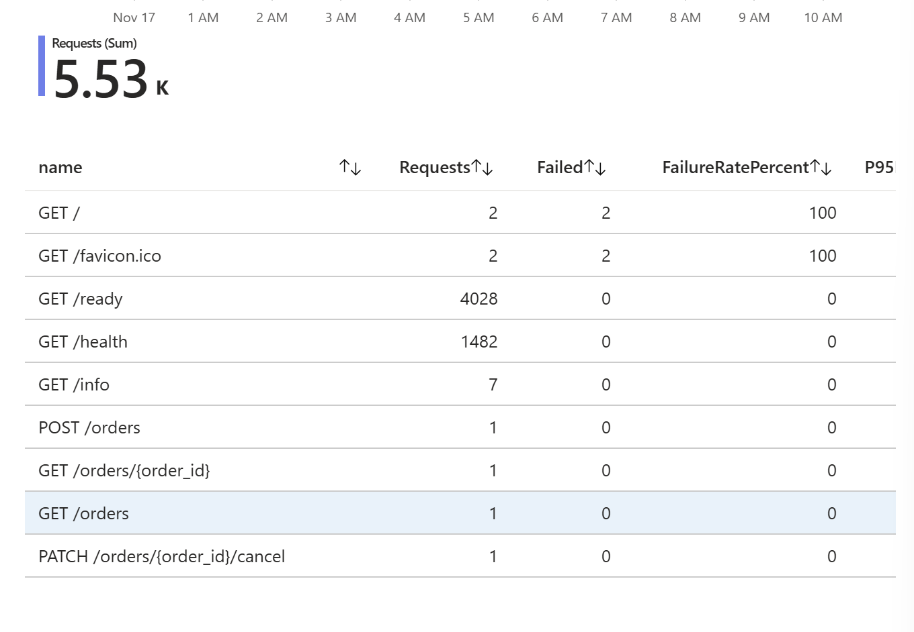

# OrderFlow

OrderFlow is a cloud-native order-management API built with FastAPI and PostgreSQL. It demonstrates a complete delivery path: tested application code, immutable container images, infrastructure as code, automated staging deployment, approval-gated production promotion, canary rollout, observability, alerting, and recovery drills.

## Live production service

- [Health check](https://ca-orderflow-api-production-swe.jollymeadow-5e459605.swedencentral.azurecontainerapps.io/health)
- [Readiness check](https://ca-orderflow-api-production-swe.jollymeadow-5e459605.swedencentral.azurecontainerapps.io/ready)
- [Build information](https://ca-orderflow-api-production-swe.jollymeadow-5e459605.swedencentral.azurecontainerapps.io/info)
- [OpenAPI documentation](https://ca-orderflow-api-production-swe.jollymeadow-5e459605.swedencentral.azurecontainerapps.io/docs)

## What this project demonstrates

- **API engineering:** FastAPI, SQLAlchemy, PostgreSQL, Alembic migrations, validation, health checks, and automated tests.
- **Container delivery:** Docker image builds, Trivy image scanning, Azure Container Registry, immutable SHA-256 image digests, and build identity exposed through `/info`.
- **Infrastructure as code:** Terraform-managed staging, production, networking, secrets, monitoring, alerts, backups, and an Azure Monitor Workbook.
- **Configuration management:** Ansible configures a Jenkins VM, Docker Compose stack, Caddy reverse proxy, and a Jenkins build agent.
- **CI/CD:** GitHub webhook-triggered Jenkins pipeline with tests, image publication, migrations, staging verification, manual production approval, and canary promotion.
- **Operations:** Application Insights OpenTelemetry instrumentation, Log Analytics, availability testing, 5xx monitoring, email alerts, cost budget alerts, and tested recovery procedures.

## Architecture



## Delivery workflow

1. A push to `main` triggers Jenkins through a GitHub webhook.
2. Jenkins formats and lints the code, runs unit and PostgreSQL integration tests, builds the API image, and scans it with Trivy.
3. The image is published to Azure Container Registry and resolved to an immutable digest.
4. A Container Apps Job runs the database migration against staging.
5. Staging deploys the same digest, waits until `/info` reports the expected Git SHA, then runs health, readiness, and order-lifecycle smoke tests.
6. A manual approval gate protects production.
7. Production migrations run before a zero-traffic candidate revision is created and validated.
8. The candidate receives 10% of production traffic. The pipeline verifies that it receives live traffic, checks candidate 5xx metrics, then either promotes it to 100% or restores the previous revision.
9. A final production smoke test and build-SHA check confirm the release.

## Production observability

The production workbook is provisioned with Terraform and presents availability, request health, latency, failed requests, PostgreSQL dependencies, and exceptions in one place.

| Availability tests | Production request traffic |
| --- | --- |
|  |  |

| Endpoint health | PostgreSQL dependency telemetry |
| --- | --- |
|  |  |

The screenshots above were captured on 17 November 2026. They show passing availability probes from West Europe, 5.53k requests over the preceding 24 hours, a 0.07% request failure rate, and live PostgreSQL dependency traces. The recorded failures are expected `404` responses for browser requests to `/` and `/favicon.ico`; API health, readiness, and order endpoints remain healthy.

### Monitoring and alerting

- Application Insights receives FastAPI, HTTP, exception, and SQLAlchemy/PostgreSQL telemetry through OpenTelemetry.
- Azure Monitor runs a production `/health` availability test from West Europe.
- Email alerts notify the production action group on health-test failure and server-error conditions.
- A monthly Azure budget sends notifications at 50%, 80%, 100%, and forecasted 100% consumption.

## Security and resilience

- Production PostgreSQL has public network access disabled and uses private networking and private DNS.
- Application secrets, including the database URL and Application Insights connection string, are stored in Azure Key Vault.
- Jenkins authenticates to Azure with a user-assigned managed identity rather than stored cloud credentials.
- The Jenkins VM is protected by Azure Backup; a disk-recovery drill restored an isolated OS disk successfully.
- PostgreSQL point-in-time recovery was tested by restoring a private temporary server, validating the `orderflow` database, and deleting the drill resources.
- The production recovery procedure is documented in [the recovery runbook](docs/runbooks/production-recovery.md).

## Technology stack

| Area | Technology |
| --- | --- |
| API | Python, FastAPI, Pydantic, SQLAlchemy |
| Database | Azure Database for PostgreSQL Flexible Server, Alembic |
| Containers | Docker, Docker Compose, Azure Container Apps, Azure Container Registry |
| Infrastructure | Terraform, Azure Key Vault, Azure Virtual Network, Private DNS |
| CI/CD | Jenkins, GitHub webhooks, Trivy |
| Configuration | Ansible, cloud-init, Caddy |
| Observability | OpenTelemetry, Application Insights, Log Analytics, Azure Monitor Workbooks and Alerts |
| Resilience | Azure Backup, PostgreSQL point-in-time restore, Azure Cost Management budget |

## API

| Method | Path | Purpose |
| --- | --- | --- |
| `POST` | `/orders` | Create a `PENDING` order. |
| `GET` | `/orders?limit=&offset=` | List orders with pagination. |
| `GET` | `/orders/{order_id}` | Retrieve one order. |
| `PATCH` | `/orders/{order_id}/cancel` | Cancel a `PENDING` order. |
| `GET` | `/health` | Check that the API process is alive. |
| `GET` | `/ready` | Check that PostgreSQL is reachable. |
| `GET` | `/info` | Report service identity, environment, and deployed Git commit. |

Example request:

```bash
curl --request POST http://localhost:8000/orders \
  --header 'Content-Type: application/json' \
  --data '{
    "customer_reference": "customer-123",
    "items": [
      {
        "product_sku": "coffee-beans",
        "quantity": 2,
        "unit_price": "12.50"
      }
    ]
  }'
```

Money values are decimal strings. New orders are `PENDING`; only `PENDING` orders can be cancelled.

## Run locally

From WSL in the repository root:

```bash
docker compose up --build -d
docker compose ps
bash scripts/smoke-test.sh
```

The local API is available at:

- Interactive documentation: <http://localhost:8000/docs>
- Liveness: <http://localhost:8000/health>
- Readiness: <http://localhost:8000/ready>

Stop the containers while preserving local database data:

```bash
docker compose down
```

To delete the local PostgreSQL volume as well, run `docker compose down -v`.

## Quality checks

```bash
uv run ruff format --check .
uv run ruff check .
uv run pytest
git diff --check
```

## Repository layout

```text
app/                FastAPI application, database models, services, telemetry
ansible/            Jenkins host and agent configuration
docker/             API container image definition
jenkins/            Declarative CI/CD pipeline
scripts/            Smoke tests and operational helpers
terraform/          Staging, production, and Jenkins infrastructure
tests/              Unit and integration tests
docs/               Architecture decisions, runbooks, and observability images
```

## Useful documentation

- [Production recovery runbook](docs/runbooks/production-recovery.md)
- [Sweden Central and shared Container Apps environment decision](docs/decisions/0003-sweden-central-and-shared-container-apps-environment.md)
